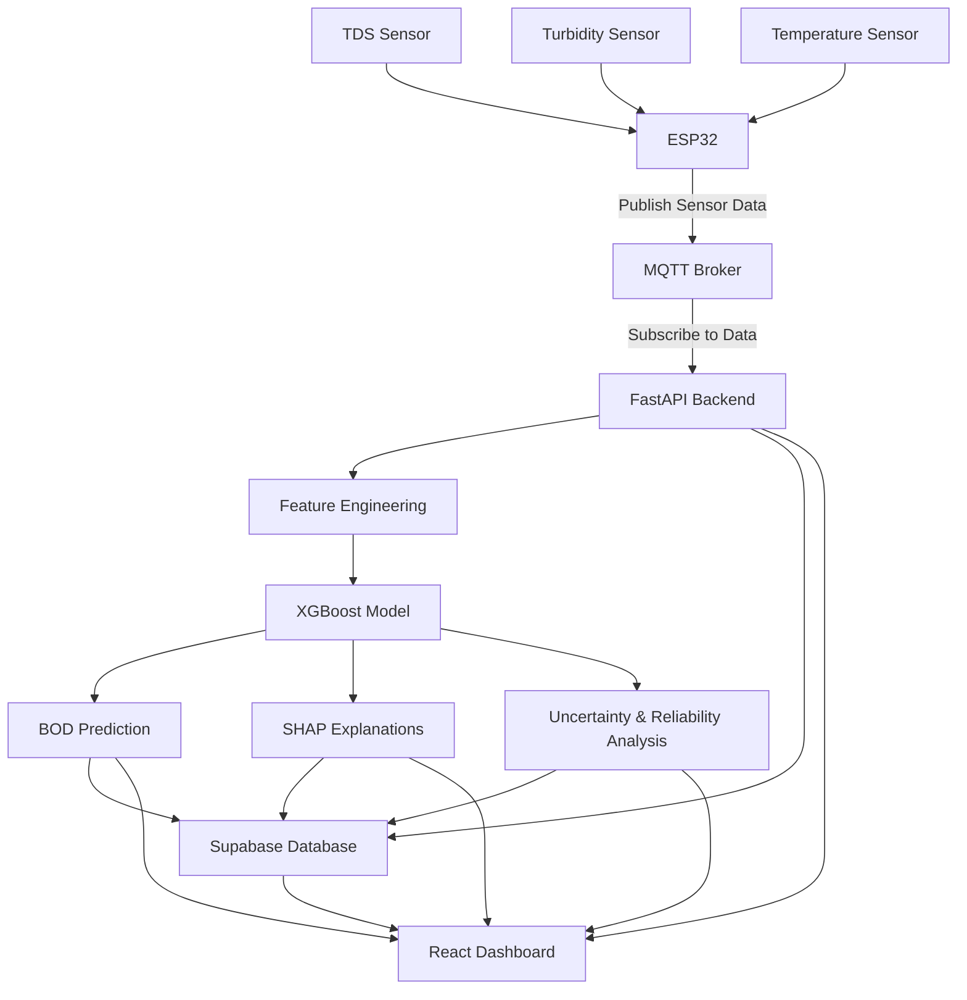

# Smart-BOD: IoT-Based Water Quality Monitoring & BOD Prediction

An IoT and machine learning-based water monitoring system that estimates **Biochemical Oxygen Demand (BOD)** using low-cost sensors, enabling accessible water quality analysis without relying entirely on expensive conventional testing equipment.

Smart-BOD combines real-time sensor acquisition, machine learning-based soft sensing, prediction explainability, and uncertainty-aware monitoring in an interactive dashboard.

## Overview

Biochemical Oxygen Demand (BOD) is an important indicator of organic pollution in water. However, its conventional measurement generally requires laboratory procedures, time, and specialized equipment.

Smart-BOD explores the use of inexpensive sensor measurements such as Total Dissolved Solids (TDS), turbidity, and temperature to estimate BOD using a machine learning model.

The system is designed not only to produce predictions, but also to communicate **how the model arrived at a prediction and how reliable that prediction may be**.

### Key Features

- Real-time water quality sensor monitoring
- IoT data transmission using MQTT
- Machine learning-based BOD prediction
- XGBoost-based soft sensor
- Feature engineering for nonlinear relationships and interactions
- SHAP-based prediction explainability
- Prediction uncertainty and confidence assessment
- Out-of-distribution (OOD) monitoring
- Interactive web dashboard
- Historical sensor readings and prediction statistics

---

## System Architecture



### Data Flow

1. **Sensor Acquisition:** Sensors measure TDS, turbidity, and water temperature.
2. **Microcontroller Processing:** ESP32 reads and prepares sensor measurements.
3. **Communication:** Sensor data is published through MQTT.
4. **Backend Processing:** FastAPI receives sensor data and coordinates the processing pipeline.
5. **Feature Engineering:** Raw measurements are transformed into model-specific features.
6. **BOD Estimation:** The XGBoost model predicts BOD.
7. **Explainability:** SHAP calculates feature contributions to the prediction.
8. **Reliability Assessment:** The system evaluates uncertainty and input distribution characteristics.
9. **Data Persistence:** Sensor measurements, predictions, and associated metadata are stored.
10. **Visualization:** The React dashboard presents live measurements, BOD estimates, reliability indicators, and historical information.

---

## Technology Stack

| Component              | Technology                                     | Purpose                                            |
| ---------------------- | ---------------------------------------------- | -------------------------------------------------- |
| Microcontroller        | ESP32                                          | Sensor acquisition and IoT connectivity            |
| Sensors                | TDS, Turbidity, Temperature                    | Collect inexpensive water quality measurements     |
| Communication Protocol | MQTT                                           | Lightweight publish-subscribe messaging            |
| Backend                | FastAPI                                        | Data processing, API services, and ML integration  |
| Machine Learning       | XGBoost                                        | Predict BOD from sensor-derived features           |
| Explainable AI         | SHAP                                           | Explain individual model predictions               |
| Reliability Analysis   | Uncertainty, Mahalanobis Distance, OOD metrics | Evaluate prediction reliability and unusual inputs |
| Database               | Supabase / PostgreSQL                          | Persistent storage of sensor and prediction data   |
| Frontend               | React                                          | Interactive monitoring dashboard                   |
| Build Tool             | Vite                                           | Frontend development and production builds         |
| Language               | Python, JavaScript                             | Backend ML pipeline and frontend                   |

---

## Machine Learning Pipeline

### Problem Statement

The objective is to estimate BOD using a limited set of inexpensive sensor inputs that may individually have weak relationships with BOD.

Rather than relying solely on direct linear relationships, the system explores nonlinear patterns, engineered features, and interactions between sensor measurements.

### Input Features

The system uses measurements from low-cost sensors:

| Sensor Parameter | Description                                               |
| ---------------- | --------------------------------------------------------- |
| TDS (ppm)        | Approximate concentration of dissolved solids             |
| Turbidity (NTU)  | Measure of water cloudiness caused by suspended particles |
| Temperature (°C) | Water temperature                                         |

### Target Variable

**Biochemical Oxygen Demand (BOD), measured in mg/L.**

### Model

**XGBoost (Extreme Gradient Boosting)**

XGBoost is used because it performs well on structured/tabular datasets and can capture nonlinear patterns, feature interactions, and complex relationships.

The model is trained to estimate BOD from sensor measurements and engineered features.

### Feature Engineering

The pipeline incorporates derived features to help the model represent different sensor relationships.

Examples include:

| Feature               | Purpose                                         |
| --------------------- | ----------------------------------------------- |
| `Log_TDS`             | Logarithmic transformation of TDS               |
| `Log_Turbidity`       | Logarithmic representation of turbidity         |
| `TDS_x_Temp`          | TDS-temperature interaction                     |
| `TDS_x_Turb`          | TDS-turbidity interaction                       |
| `Turb_x_Temp`         | Turbidity-temperature interaction               |
| `Turb_diff1`          | Turbidity change between observations           |
| `Turb_roll_max`       | Rolling maximum turbidity                       |
| `Sqrt_Turbidity`      | Square-root transformation                      |
| `Turb_to_TDS_Ratio`   | Relative relationship between turbidity and TDS |
| `TDS_TempCompensated` | Temperature-compensated TDS representation      |

Feature engineering is used to expose patterns that may not be easily captured from raw measurements alone.

---

## Model Explainability

### SHAP (SHapley Additive exPlanations)

Smart-BOD integrates SHAP to interpret the model's predictions.

Instead of displaying only the predicted BOD value, the system provides insight into which features contributed to a prediction and the direction of their contribution.

The dashboard presents the most influential features, their contribution values, and whether they pushed the prediction higher or lower relative to the model's baseline.

This helps make the model's behaviour more interpretable.

> SHAP contributions describe model behaviour, not causal relationships in water chemistry.

---

## Prediction Reliability & Uncertainty

Because BOD is being estimated using indirect measurements, predictions may be unreliable in certain conditions. Smart-BOD incorporates reliability indicators to communicate this limitation rather than treating every prediction as equally trustworthy.

### Reliability Components

| Metric               | Purpose                                                                |
| -------------------- | ---------------------------------------------------------------------- |
| Prediction Interval  | Displays a range associated with prediction uncertainty                |
| Confidence Score     | Provides a system-derived prediction reliability score                 |
| Confidence Tier      | Categorizes predictions into reliability levels                        |
| Mahalanobis Distance | Measures how unusual an input is relative to a reference distribution  |
| OOD Factor           | Represents an out-of-distribution signal used by the reliability logic |

These metrics help identify predictions that should be interpreted cautiously.

**The reliability layer is particularly important when sensor inputs do not adequately represent the water quality conditions encountered by the model.**

---

## Dashboard

The web dashboard provides an overview of the monitoring system.

### Dashboard Sections

- **BOD Prediction:** Estimated BOD value and prediction interval
- **Prediction Confidence:** Confidence score, tier, and reliability indicators
- **Sensor Readings:** Current TDS, turbidity, and temperature
- **Model Reliability:** Mahalanobis distance, OOD factor, and current assessment
- **BOD Trend:** Historical prediction visualization
- **Sensor Trends:** Historical behaviour of sensor measurements
- **Prediction Explainability:** SHAP feature contributions
- **System Statistics:** Total readings, averages, minimums, and maximums
- **Recent Readings:** Tabular history of received sensor data

---

## API

The backend exposes API endpoints for accessing sensor readings, historical data, and device statistics.

| Endpoint                         | Method | Description                                                        |
| -------------------------------- | ------ | ------------------------------------------------------------------ |
| `/api/readings/latest`           | GET    | Retrieves the latest sensor reading and associated prediction data |
| `/api/readings/history?limit=10` | GET    | Retrieves recent historical readings                               |
| `/api/stats?device_id=device-01` | GET    | Retrieves aggregated device statistics                             |

Interactive API documentation is available through FastAPI's Swagger UI.

```text
http://localhost:8000/docs
```

---

## Project Structure

```text
Smart-BOD/
│
├── backend/
│   ├── main.py
│   ├── model_predictor.py
│   ├── ...
│   ├── requirements.txt
│   └── ...
│
├── frontend/
│   ├── src/
│   │   ├── components/
│   │   ├── pages/
│   │   ├── ...
│   │   └── ...
│   ├── package.json
│   └── ...
│
├── firmware/
│   └── ...
│
├── model/
│   └── ...
│
├── README.md
└── ...
```

_Note: The structure above is a high-level representation. Update the directory names according to the actual repository structure._

---

## Getting Started

### Prerequisites

- Python 3.10+
- Node.js and npm
- ESP32 development board
- Compatible TDS, turbidity, and temperature sensors
- MQTT broker
- Supabase project (if using cloud persistence)
- Git

### 1. Clone the Repository

```bash
git clone https://github.com/<your-username>/<your-repository>.git
cd Smart-BOD
```

### 2. Backend Setup

Navigate to the backend directory:

```bash
cd backend
```

Create and activate a virtual environment:

```bash
python3 -m venv venv
source venv/bin/activate
```

Install dependencies:

```bash
pip install -r requirements.txt
```

Configure your environment variables according to the backend configuration.

Create a `.env` file if required:

```env
MQTT_BROKER_HOST=your_mqtt_broker
MQTT_BROKER_PORT=your_mqtt_port

SUPABASE_URL=your_supabase_url
SUPABASE_KEY=your_supabase_key
```

Start the backend server:

```bash
uvicorn main:app --reload --port 8000
```

Backend API:

```text
http://localhost:8000
```

Swagger Documentation:

```text
http://localhost:8000/docs
```

### 3. Frontend Setup

Open another terminal and navigate to the frontend:

```bash
cd frontend
```

Install dependencies:

```bash
npm install
```

Start the development server:

```bash
npm run dev
```

The frontend will typically be accessible at:

```text
http://localhost:5173
```

### 4. Hardware Setup

Connect the sensors to the ESP32 according to the wiring configuration defined in the firmware.

Ensure:

- Sensor power requirements are satisfied.
- Ground connections are shared where required.
- Analog sensor outputs are connected to appropriate ESP32 ADC pins.
- Sensor outputs do not exceed the ESP32's input voltage limits.
- Firmware uses the correct sensor calibration and conversion logic.

Upload the firmware to the ESP32 and ensure it connects to the configured Wi-Fi network and MQTT broker.

---

## Configuration

Before running the project, configure the following:

| Configuration        | Description                             |
| -------------------- | --------------------------------------- |
| Wi-Fi credentials    | Network connection for the ESP32        |
| MQTT broker address  | Broker used for device communication    |
| MQTT topic           | Topic used for sensor data publishing   |
| Supabase URL         | Cloud database endpoint                 |
| Supabase credentials | Backend database access                 |
| API configuration    | Backend/frontend communication          |
| Model path           | Location of the trained model artifacts |

Never commit API keys, passwords, private credentials, or `.env` files to GitHub.

---

## Research Motivation

Low-cost water quality monitoring can improve accessibility to water analysis by reducing reliance on expensive measurement equipment for frequent monitoring.

However, parameters such as BOD are not directly measured by the inexpensive sensors used in this system. Their estimation is therefore a machine learning problem with inherent limitations.

Smart-BOD explores:

- Soft sensing of water quality parameters
- Estimation of expensive measurements from inexpensive sensors
- Feature engineering under limited input availability
- Nonlinear machine learning for environmental data
- Model explainability
- Prediction uncertainty and reliability-aware monitoring

The project does not assume that low-cost sensor measurements can fully replace laboratory methods. Instead, it investigates their potential for estimation, monitoring, and decision-support applications.

---

## Limitations

- TDS, turbidity, and temperature may have weak or indirect relationships with BOD.
- Sensor noise, drift, calibration errors, and environmental conditions can affect readings.
- Prediction performance depends on the quality, representativeness, and distribution of training data.
- Unusual inputs may produce unreliable predictions.
- SHAP explains model behaviour but does not establish causality.
- Reliability metrics are estimates and do not guarantee correctness.
- The system is an experimental soft sensor and should not replace validated laboratory measurements for regulatory or critical decisions.

---

## Future Scope

- Integration of additional low-cost sensors.
- Incorporation of dissolved oxygen and other water quality parameters.
- Improved calibration and sensor drift correction.
- Larger and more diverse training datasets.
- Testing additional ML models and feature selection strategies.
- Improved uncertainty calibration and out-of-distribution detection.
- Deployment to cloud infrastructure.
- Multi-device and multi-location monitoring.
- Automated alerts for abnormal readings.
- Long-term validation against laboratory-measured BOD values.
- Exploration of advanced soft-sensing and transfer-learning approaches.

---

## Contributors

Developed as an academic and research-oriented project exploring IoT-based water quality monitoring and machine learning soft sensing.

---

## Disclaimer

Smart-BOD is an experimental research and monitoring system. Its BOD estimates are model-generated predictions based on indirect sensor measurements and should not be interpreted as laboratory-certified water quality results.
